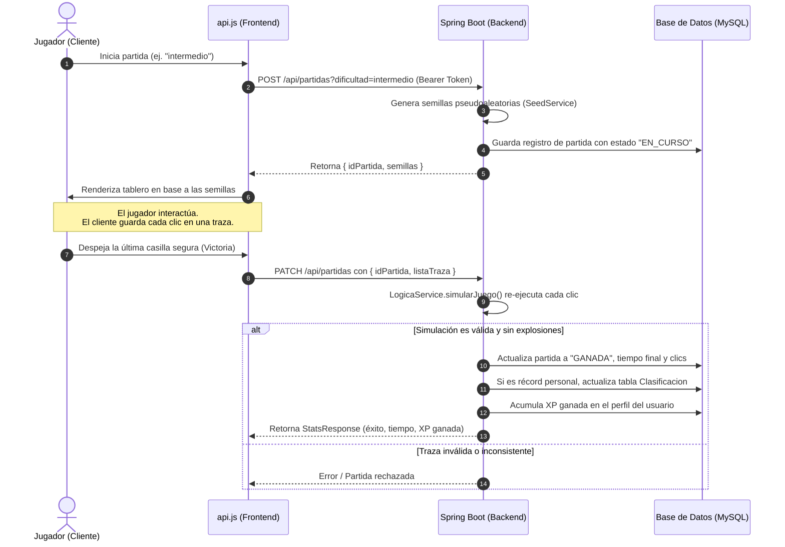

# 💣 Minesweeper Neon

> **Proyecto de plataforma competitiva del clásico Buscaminas**, construida sobre una arquitectura **Full-Stack desacoplada** con backend en **Spring Boot**, interfaz web modular en **Vanilla JavaScript/CSS**, verificación de partidas en servidor contra trampas (*server-side replay validation*) y tabla de clasificación global.

---

## 📌 Tabla de Contenidos

- [Descripción General](#-descripción-general)
- [Características Principales](#-características-principales)
- [Arquitectura del Sistema](#-arquitectura-del-sistema)
- [Estructura del Proyecto](#-estructura-del-proyecto)
- [Stack Tecnológico](#-stack-tecnológico)
- [Endpoints de la API REST](#-endpoints-de-la-api-rest)
- [Flujo de Seguridad y Anti-Cheat](#-flujo-de-seguridad-y-anti-cheat)
- [Instalación y Configuración Local](#-instalación-y-configuración-local)
  - [Prerrequisitos](#prerrequisitos)
  - [1. Configuración de Base de Datos](#1-configuración-de-base-de-datos)
  - [2. Ejecución del Backend](#2-ejecución-del-backend)
  - [3. Ejecución del Frontend](#3-ejecución-del-frontend)
- [Pruebas (Testing)](#-pruebas-testing)
- [Licencia y Autor](#-licencia-y-autor)

---

## 📖 Descripción General

**Minesweeper Neon** consiste en una aplicación web tradicional sobre el juego Buscaminas adaptado un entorno moderno y competitivo. A diferencia de implementaciones convencionales del lado del cliente donde los récords y tiempos se pueden manipular fácilmente en la consola del navegador, este proyecto implementa un **sistema de validación de partidas desde el backend**:

1. El servidor genera una semilla criptográfica para el tablero al comenzar la partida.
2. El cliente registra la secuencia exacta de movimientos y clics del jugador.
3. Al finalizar, el backend reproduce la partida completa para certificar que el jugador no detonó minas indebidas ni alteró el tiempo antes de registrar récords o conceder puntos de experiencia (XP).

Todo esto se complementa con una estética estilo neón y usando display digital de 7 segmentos, perfiles de jugador y un sistema de clasificación global con filtros avanzados.

---

## ✨ Características Principales

### 🎮 Jugabilidad y Experiencia
- **3 Modos de Dificultad**:
  - **Fácil**: 9 × 9 casillas (10 minas).
  - **Intermedio**: 16 × 16 casillas (40 minas).
  - **Difícil**: 20 × 30 casillas (99 minas).
- **Display Digital Retro**: Cronómetro y contador de banderas estilo 7 segmentos (*DSEG7 Classic*).
- **Mecánicas avanzadas**: Sistema de banderas (clic derecho), revelado adyacente rápido (*chording*), sistema de pistas y controles de zoom y pantalla completa.
- **Estadísticas en Tiempo Real**: Clics izquierdos, clics derechos, tiempo preciso en milisegundos y cálculo de XP ganada.

### 🛡️ Backend Robusto y Anti-Cheat
- **Generación de Semillas (`SeedService`)**: Los tableros se construyen de manera determinística bajo demanda.
- **Verificación de Traza (`LogicaService`)**: Validación de la secuencia completa de jugadas en el servidor previa a la persistencia de victorias.
- **Control de Estados**: Transición estricta de estados de partida (`EN_CURSO` → `GANADA` / `PERDIDA`).

### 🔐 Seguridad y Autenticación
- **Autenticación sin estado (Stateless)** mediante **JWT (JSON Web Tokens)** con firma segura.
- **Cifrado de Contraseñas** con **BCrypt** a través de Spring Security.
- Manejo centralizado de autorización con cabeceras `Authorization: Bearer <token>`.

### 🏆 Clasificación Global (Leaderboard)
- Ranking de los **mejores 25 tiempos** históricos.
- **Filtros dinámicos reactivos**: consulta por dificultad, país del jugador (con banderas) y mes/año.
- Cálculo automático de récords personales por usuario y gamemode.

---

## 🏛️ Arquitectura del Sistema

```
┌────────────────────────────────────────────────────────┐
│                   CLIENTE (Frontend)                   │
│  Vanilla JS (ES6+)  ·  HTML5  ·  CSS3 (Variables/Grid) │
│  [ auth/ ]         [ inicio/ ]         [ juego/ ]      │
└───────────────────────────┬────────────────────────────┘
                            │  Peticiones HTTP (JSON + JWT)
                            ▼
┌────────────────────────────────────────────────────────┐
│                   CLIENTE API (api.js)                 │
│         fetch centralizado + Auth Bearer Header         │
└───────────────────────────┬────────────────────────────┘
                            │  REST API
                            ▼
┌────────────────────────────────────────────────────────┐
│                   BACKEND (Spring Boot)                │
│  ┌──────────────────────────────────────────────────┐  │
│  │ Capa de Controladores (REST Endpoints)           │  │
│  ├──────────────────────────────────────────────────┤  │
│  │ Capa de Seguridad (Spring Security + JWT Filter) │  │
│  ├──────────────────────────────────────────────────┤  │
│  │ Capa de Servicios & Lógica de Simulación         │  │
│  │  - PartidaService       - SeedService            │  │
│  │  - LogicaService        - UsuarioService         │  │
│  ├──────────────────────────────────────────────────┤  │
│  │ Persistencia (Spring Data JDBC)                  │  │
│  └──────────────────────────┬───────────────────────┘  │
└─────────────────────────────┼──────────────────────────┘
                              │  Conector JDBC
                              ▼
┌────────────────────────────────────────────────────────┐
│               BASE DE DATOS (MySQL 8.x)                │
│       Tablas: Usuarios · Partidas · Clasificacion      │
└────────────────────────────────────────────────────────┘
```

---

## 📂 Estructura del Proyecto

```
PROYECTO_MINESWEPER/
├── backend/                             # API REST en Spring Boot (Java 21)
│   ├── mvnw / mvnw.cmd                  # Maven Wrapper
│   ├── pom.xml                          # Dependencias y configuración de compilación
│   └── src/main/
│       ├── java/backend/
│       │   ├── config/                  # Configuraciones (CORS, beans de seguridad)
│       │   ├── controller/              # Controladores REST (Usuario, Partida, Clasificación)
│       │   ├── dto/                     # Objetos de Transferencia de Datos (Requests / Responses)
│       │   ├── exception/               # Manejo global de excepciones
│       │   ├── model/                   # Entidades del dominio (Usuario, Partida, Tablero, etc.)
│       │   ├── repository/              # Repositorios Spring Data JDBC
│       │   ├── security/                # Filtros y generadores de tokens JWT
│       │   └── service/                 # Lógica de negocio, semillas y simulación de jugadas
│       └── resources/
│           └── application.properties   # Configuración de base de datos y parámetros JWT
│
├── Frontend/                            # Aplicación Web cliente (Vanilla Web Stack)
│   ├── assets/                          # Recursos gráficos (iconos, imágenes de banderas y relojes)
│   ├── playwright.config.js             # Configuración de pruebas automatizadas E2E
│   ├── package.json                     # Scripts y dependencias de testing (Playwright)
│   ├── tests/                           # Especificaciones de pruebas E2E
│   └── src/
│       ├── api.js                       # Módulo unificado para llamadas fetch al Backend
│       ├── styles.css                   # Sistema de diseño global y variables CSS
│       ├── auth/                        # Módulo de Autenticación
│       │   ├── login.html               # Formulario de inicio de sesión
│       │   ├── registrar.html           # Formulario de registro de nuevo usuario
│       │   ├── auth.css                 # Estilos específicos de formularios y cajas
│       │   └── auth.js                  # Manejo de eventos y consumo de /usuarios/login y register
│       ├── inicio/                      # Módulo de Menú y Clasificaciones
│       │   ├── menu.html                # Selección de partidas y vista de tabla de clasificación
│       │   ├── menu.css                 # Estilos del menú neon, barra superior y modales
│       │   ├── menu.js                  # Lógica de navegación e interacción del menú
│       │   └── clasificacion.js         # Consumo y renderizado del ranking global con filtros
│       └── juego/                       # Módulo del Tablero y Mecánicas del Juego
│           ├── panel_tablero.html       # Vista aislada del tablero y controles
│           ├── juego.js                 # Inicialización y ciclo de vida de la partida
│           ├── logica.js                # Lógica de casillas, minas adyacentes y estado
│           ├── click.js                 # Manejo de eventos de clic izquierdo, derecho y chording
│           ├── plantilla.js             # Generador dinámico de elementos DOM para la cuadrícula
│           ├── stats.js                 # Rastreo de métricas y empaquetado de traza para la API
│           └── styles.css               # Estilos del tablero, celdas y efectos visuales neon
│
└── README.md                            # Documentación principal del repositorio
```

---

## 🛠️ Stack Tecnológico

| Capa | Tecnologías |
| :--- | :--- |
| **Frontend** | HTML5 semántico, CSS3 moderno (Custom Properties, Flexbox, Grid), JavaScript (ES6+ Vanilla), DSEG7 Classic Font |
| **Backend** | Java 21, Spring Boot 4, Spring Security, Spring Data JDBC, Lombok, Jackson |
| **Seguridad** | JSON Web Tokens (JJWT 0.11.5), BCrypt Password Encoder |
| **Base de Datos** | MySQL 8.x |
| **Testing** | Playwright (E2E), Spring Boot Test (WebMvcTest, DataJdbcTest) |
| **Herramientas** | Maven Wrapper, Git |

---

## 📡 Endpoints de la API REST

### 1. Autenticación (`/usuarios`)
| Método | Ruta | Auth | Descripción |
| :--- | :--- | :---: | :--- |
| `POST` | `/usuarios/register` | No | Registra un nuevo usuario con nombre, correo, país y contraseña. |
| `POST` | `/usuarios/login` | No | Autentica credenciales y retorna un token JWT firmado. |

### 2. Partidas (`/api/partidas`)
| Método | Ruta | Auth | Descripción |
| :--- | :--- | :---: | :--- |
| `POST` | `/api/partidas?dificultad={facil\|intermedio\|dificil}` | **JWT** | Inicializa una nueva partida en el servidor y entrega la semilla determinística para el tablero. |
| `PATCH` | `/api/partidas` | **JWT** | Envía la traza de clics de una partida ganada. El servidor la valida, calcula el tiempo exacto, actualiza estadísticas y suma XP. |

### 3. Clasificación (`/api/clasificacion`)
| Método | Ruta | Auth | Descripción |
| :--- | :--- | :---: | :--- |
| `GET` | `/api/clasificacion` | No | Devuelve el ranking de los 25 mejores tiempos. Parámetros opcionales: `modo` *(requerido)*, `pais`, `fecha` (`YYYY-MM`). |

---

## 🔄 Flujo de Seguridad y Anti-Cheat



---

## 🚀 Instalación y Configuración Local

### Prerrequisitos
- **Java Development Kit (JDK) 21** o superior instalado.
- **MySQL Server 8.x** en ejecución en `localhost:3306`.
- **Node.js** (opcional, únicamente si se desea ejecutar las pruebas automatizadas con Playwright).

---

### 1. Configuración de Base de Datos

1. Creá la base de datos en MySQL:
   ```sql
   CREATE DATABASE minesweeper CHARACTER SET utf8mb4 COLLATE utf8mb4_unicode_ci;
   ```

2. Configurá las variables de entorno para que Spring Boot pueda autenticarse con tu base de datos:
   - En **Windows (PowerShell)**:
     ```powershell
     $env:DB_USER="tu_usuario_mysql"
     $env:DB_PASSWORD="tu_password_mysql"
     ```
   - En **Linux / macOS**:
     ```bash
     export DB_USER="tu_usuario_mysql"
     export DB_PASSWORD="tu_password_mysql"
     ```

> **Nota**: Podés revisar y ajustar estos valores en [`backend/src/main/resources/application.properties`](backend/src/main/resources/application.properties).

---

### 2. Ejecución del Backend

Navegá a la carpeta `backend/` y arrancá la aplicación utilizando el wrapper de Maven:

- **Windows**:
  ```powershell
  cd backend
  .\mvnw.cmd spring-boot:run
  ```

- **Linux / macOS**:
  ```bash
  cd backend
  ./mvnw spring-boot:run
  ```

El servidor iniciará en `http://localhost:8080`.

---

### 3. Ejecución del Frontend

1. Si tu backend se ejecuta en un puerto o dominio distinto a `http://localhost:8080`, actualizá la constante `API_BASE_URL` en [`Frontend/src/api.js`](Frontend/src/api.js).
2. Serví la carpeta `Frontend/` con cualquier servidor estático:
   - Con la extensión **Live Server** de Visual Studio Code: hacé clic derecho en [`Frontend/src/inicio/menu.html`](Frontend/src/inicio/menu.html) o [`Frontend/src/auth/login.html`](Frontend/src/auth/login.html) y seleccioná **Open with Live Server**.
   - Con Python:
     ```bash
     cd Frontend
     python -m http.server 3000
     ```
   - Con `npx serve`:
     ```bash
     cd Frontend
     npx serve .
     ```
3. Abrí tu navegador e ingresá a la URL local (por defecto `http://127.0.0.1:5500/src/inicio/menu.html` o similar).

---

## 🧪 Pruebas (Testing)

El proyecto cuenta con suites de pruebas tanto en el backend como en el cliente web:

### Backend
Para correr las pruebas unitarias y de integración de controladores y repositorios:
```bash
cd backend
./mvnw test
```

### Frontend (Playwright)
Para ejecutar las pruebas de interfaz de usuario de extremo a extremo:
```bash
cd Frontend
npm install
npx playwright test
```

---

## 👤 Autor

Desarrollado por **Jorge** ([@Jorgefhh](https://github.com/Jorgefhh)).  

